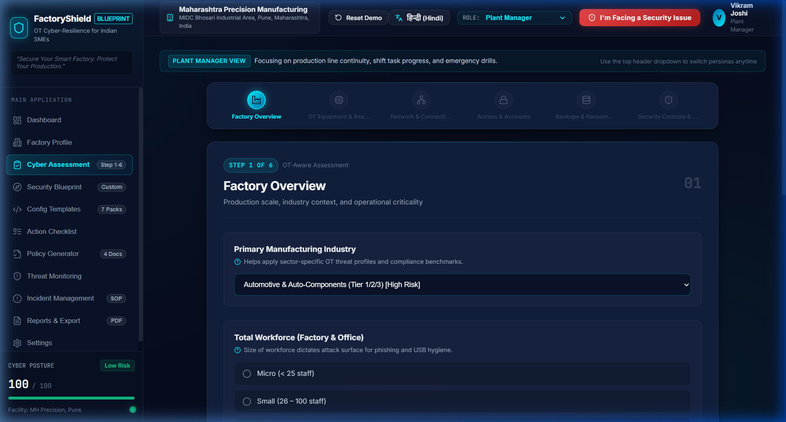
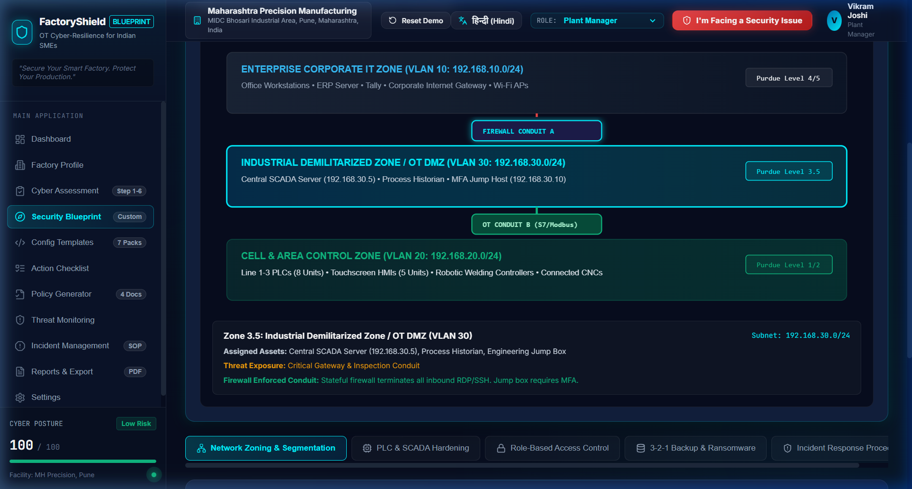
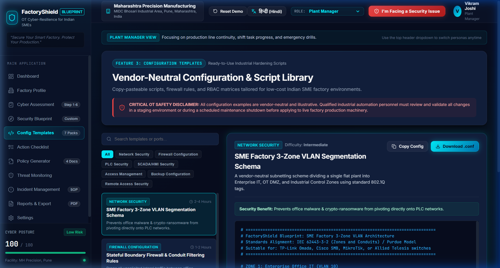
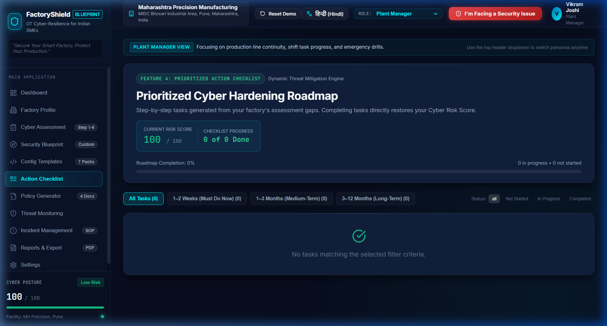
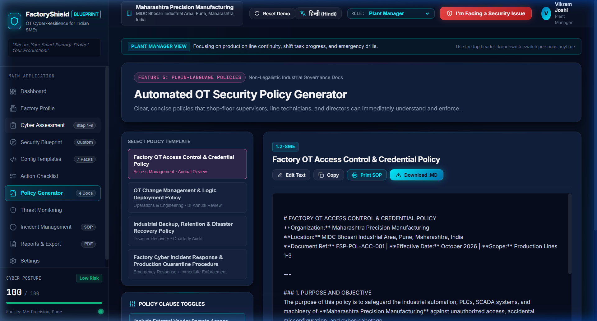
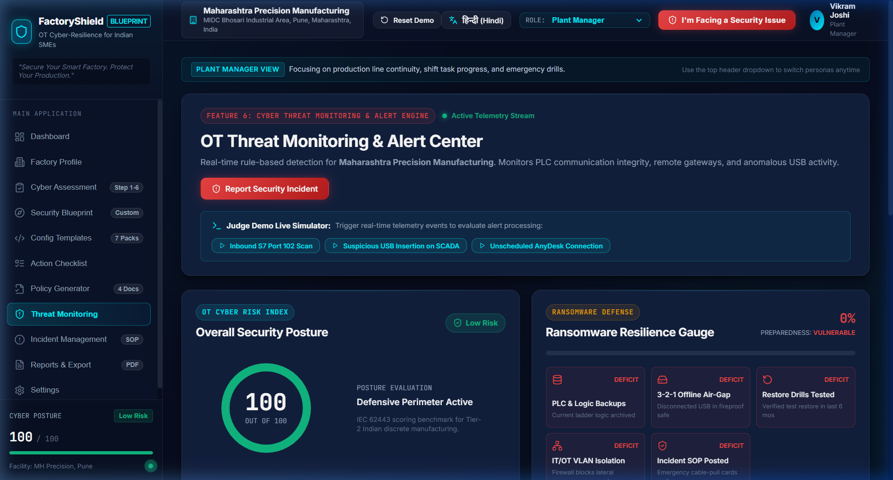
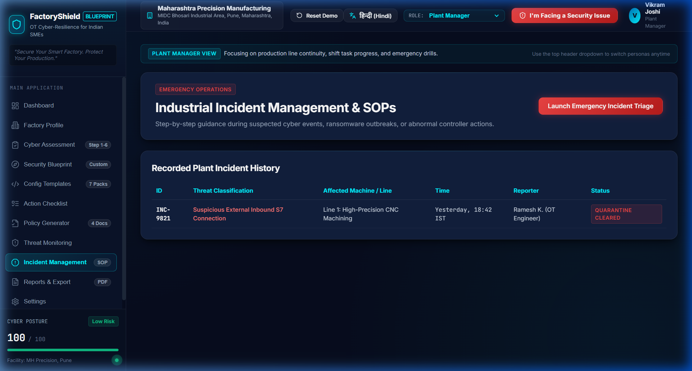

# FactoryShield Blueprint

<p align="center">
  
  
  
  
</p>

<p align="center">
  <strong>"Secure Your Smart Factory. Protect Your Production."</strong><br>
  <em>An affordable, step-by-step OT cybersecurity assessment, custom architecture blueprint generator, and threat telemetry monitoring platform for Indian manufacturing factories.</em>
</p>

---

## 📌 Table of Contents
1. [Problem Statement](#-problem-statement)
2. [Solution Overview](#-solution-overview)
3. [Demonstration Factory: Pune Automotive](#-demonstration-factory-pune-automotive)
4. [Key Features & Architecture](#-key-features--architecture)
   - [Feature 1: Interactive OT-Aware Questionnaire](#1-interactive-ot-aware-questionnaire)
   - [Feature 2: Custom Security Blueprint & Purdue Model Topology](#2-custom-security-blueprint--purdue-model-topology)
   - [Feature 3: Vendor-Neutral Configuration Templates](#3-vendor-neutral-configuration-templates)
   - [Feature 4: Prioritized Action Checklist with Live Score Engine](#4-prioritized-action-checklist-with-live-score-engine)
   - [Feature 5: Plain-Language Policy Documentation Generator](#5-plain-language-policy-documentation-generator)
   - [Feature 6: Cyber Threat Monitoring & Emergency Incident Triage](#6-cyber-threat-monitoring--emergency-incident-triage)
5. [Demonstration Video](#-demonstration-video)
6. [Technology Stack](#-technology-stack)
7. [Installation & Local Setup](#-installation--local-setup)
8. [2-Minute Hackathon Presentation Guide](#-2-minute-hackathon-presentation-guide)
9. [Future Enhancements & Production Roadmap](#-future-enhancements--production-roadmap)
10. [License & Credits](#-license--credits)

---

## 🏭 Problem Statement

Small and medium-sized manufacturing factories across India (Pune, Rajkot, Peenya, Coimbatore, Manesar) are rapidly adopting Industry 4.0 automation: connected Programmable Logic Controllers (PLCs), Supervisory Control and Data Acquisition (SCADA) systems, Human-Machine Interfaces (HMIs), industrial IoT sensors, and cloud ERP systems.

However, they face severe operational cybersecurity deficits:
- **No In-House OT Security Talent:** SME factories cannot afford specialized industrial SOC services or enterprise OT security platforms (e.g. Claroty, Dragos, Nozomi).
- **Vulnerable Flat Networks:** Office PCs, accounting laptops, and shop-floor PLCs share a single unsegmented subnet (`192.168.1.0/24`), enabling ransomware from a single phishing email to jump directly to production controllers within minutes.
- **Shared & Default Credentials:** Machine touchscreens (HMIs) and controllers frequently run on factory default passwords (`admin/admin`, `1234`), with shift workers sharing generic accounts.
- **Unprotected Remote Vendor Access:** OEM maintenance vendors connect over unmanaged desktop tools (AnyDesk, TeamViewer) without VPNs or Multi-Factor Authentication.
- **Missing or Untested Backups:** PLC ladder logic and recipe setpoints are rarely backed up, meaning ransomware encryption halts delivery for weeks, risking crippling OEM line-stoppage penalties.
- **Complex Standards:** Frameworks like IEC 62443 and NIST CSF are hard to interpret and implement without a practical, low-cost guide.

---

## 💡 Solution Overview

**FactoryShield Blueprint** provides a pragmatic, visual, vendor-neutral web platform that translates complex industrial standards into affordable, concrete actions tailored for Indian plant managers, factory owners, and automation technicians.

```
┌────────────────────────────────────────────────────────────────────────────────────────┐
│                               FACTORYSHIELD BLUEPRINT ENGINE                           │
├─────────────────────┬──────────────────────────┬───────────────────────────────────────┤
│  1. ASSESS          │  2. ARCHITECT & HARDEN   │  3. MONITOR & RESPOND                 │
│  • Visual 6-Step    │  • Purdue Network Zones  │  • Real-Time Threat Telemetry Stream  │
│    OT Questionnaire │  • Controller Hardening  │  • 0-100 Radial Risk Index            │
│  • Asset Inventory  │  • RBAC Permissions      │  • Ransomware Readiness Gauge         │
│  • English & हिंदी  │  • 3-2-1 Offline Vault   │  • Emergency "Pull the Cable" SOP     │
└─────────────────────┴──────────────────────────┴───────────────────────────────────────┘
```

---

## 🚗 Demonstration Factory: Pune Automotive

The application comes pre-seeded with a realistic demonstration facility designed for immediate hackathon evaluation:

- **Factory Name:** Maharashtra Precision Manufacturing
- **Location:** MIDC Bhosari Industrial Area, Pune, Maharashtra, India
- **Sector:** Tier-2 Automotive Transmission & Engine Components Producer
- **Operational Scale:** 3 Automated Lines (Line 1: High-Precision CNC Machining, Line 2: Robotic Welding, Line 3: Stamping & Assembly), 85 personnel.
- **Registered OT Assets:** 8 PLCs (Siemens S7-1200/S7-1500, Schneider Modicon, Delta), 2 Central SCADA Servers (WinCC V7.5, Wonderware InTouch), 5 Touchscreen HMIs, 12 IIoT Vibration/Energy Sensors, 3 Engineering Laptops.
- **Financial Sensitivity:** Acceptable downtime threshold is under 4 hours before OEM tier-penalties apply.

---

## ⚡ Key Features & Architecture

### 1. Interactive OT-Aware Questionnaire
A guided 6-step assessment wizard covering factory scale, connected equipment, network segmentation, credential hygiene, backup readiness, and physical cabinet controls.

- **Visual Asset Selection:** Interactive cards for PLCs, SCADA, HMIs, CNCs, Robots, IoT sensors, and Engineering workstations.
- **SME-Friendly Language:** Contextual tooltips explaining technical terms in plain analogies with an **English / हिंदी** label toggle.
- **Adaptive Scoring:** Includes an *"I don't know / Not sure"* option safely penalized as high-risk to eliminate hidden blinds spots.

<p align="center">
  
</p>

---

### 2. Custom Security Blueprint & Purdue Model Topology
A deterministic rules engine evaluates responses against **IEC 62443** (Zones & Conduits) and **NIST CSF** (Identify, Protect, Detect, Respond, Recover) to construct a tailored plant defense blueprint.

- **Interactive Purdue Model SVG Diagram:** Visualizes Enterprise IT (VLAN 10), Industrial DMZ (VLAN 30), and Cell/Area Control (VLAN 20) with live conduit filtering rules and IP address schemes.
- **Modular Hardening Specifications:** Deep-dive tabs for PLC keyswitch lockdown, embedded web server deactivation, RBAC permissions matrix, and 3-2-1 backup rotation.

<p align="center">
  
</p>

---

### 3. Vendor-Neutral Configuration Templates
A searchable, copy-pasteable configuration library organized across **7 categories**:
1. **Network Security:** 3-Zone VLAN segmentation schema for small factory switches.
2. **Firewall Configuration:** Stateful pfSense/iptables conduit rules blocking lateral IT-to-OT traffic while permitting SCADA polling (ports 102 and 502).
3. **PLC Security:** Industrial controller hardware keyswitch and firmware protection checklist.
4. **SCADA/HMI Security:** PowerShell script for Windows 10/11 IoT disabling USB AutoRun and configuring anti-malware process exclusions.
5. **Access Management:** Role-Based Access Control matrix separating Operators, Supervisors, Engineers, and Contractors.
6. **Backup Configuration:** Automated PowerShell script executing local hashing, compression, and 3-2-1 air-gap export reminders.
7. **Remote Access Security:** WireGuard / OpenVPN jump host configuration with time-limited vendor maintenance windows.

<p align="center">
  
</p>

---

### 4. Prioritized Action Checklist with Live Score Engine
An automated remediation roadmap categorized into three horizons:
- **Immediate Actions (1–2 weeks):** Low/zero cost quick wins (change default credentials, revoke unattended AnyDesk, capture baseline PLC backups).
- **Medium-Term Actions (1–3 months):** Substantial structural protections (managed switch VLAN separation, 3-2-1 offline rotating drives).
- **Long-Term Actions (3–12 months):** Strategic resilience (passive network sensors, semi-annual recovery drills, shift cyber hygiene talks).

**Dynamic Score Recovery:** Marking tasks as `Completed` directly recalculates and recovers points on the 0–100 Cyber Risk Index with celebratory confetti feedback.

<p align="center">
  
</p>

---

### 5. Plain-Language Policy Documentation Generator
Automatically populates and formats 4 essential shop-floor governance policies in readable, non-legalistic language:
1. **OT Access Control & Credential Policy**
2. **OT Change Management & Logic Deployment Policy**
3. **Industrial Backup, Retention & Disaster Recovery Policy**
4. **Factory Cyber Incident Response & Production Quarantine Procedure**

Features customizable clause toggles (e.g. mobile phone USB charging ban, USB quarantine kiosk rule, break-glass emergency procedures), live Markdown editing, and clean print/export styling.

<p align="center">
  
</p>

---

### 6. Cyber Threat Monitoring & Emergency Incident Triage
A dedicated operational threat telemetry center designed for plant managers and supervisors:
- **Radial Risk Score Gauge:** Real-time 0–100 index with High (0–40), Medium (41–70), and Low (71–100) risk classifications.
- **Ransomware Readiness Meter:** 5-factor evaluation of backup recency, offline air-gap custody, restore drills, VLAN isolation, and SOP postings.
- **Judge Demo Live Simulator:** One-click simulation of realistic shop-floor telemetry (Inbound S7 Port 102 sweeps, suspicious USB insertions, off-hours remote desktop logins) with live mitigation controls.
- **Emergency Incident Modal ("I'm Facing a Security Issue"):** Instant triage workflow providing physical containment checklists (*"DO NOT REBOOT"*, *"Physically pull the Ethernet RJ45 cable"*, *"Press E-Stop if safety is at risk"*) and active quarantine logging.

<p align="center">
  
</p>

<p align="center">
  
</p>

---

## 🎥 Demonstration Video

A 2-minute demonstration video is included directly in the repository root:

- **File:** [`FactoryShield_Demo.mp4`](FactoryShield_Demo.mp4)
- **Resolution:** 1280x720 HD (16:9)
- **Duration:** 02:00
- **Size:** 2.54 MB (H.264 MP4 with progressive streaming)

### Demonstration Flow:
1. **0:00 – 0:15:** Dashboard overview, Pune automotive context, initial risk posture (20/100 High Risk).
2. **0:16 – 0:23:** Security Blueprint view with interactive Purdue Model network topology.
3. **0:24 – 0:27:** Action Checklist with dynamic score tracking.
4. **0:28 – 0:35:** 6-Step OT Assessment wizard with visual equipment cards.
5. **0:36 – 0:43:** Threat Monitoring Telemetry Center.
6. **0:44 – 0:52:** Simulated S7 Port 102 Scan triggered and mitigated live.
7. **0:53 – 01:42:** Emergency Incident Triage modal for Suspected Ransomware with physical containment checkboxes.
8. **01:43 – 01:56:** Incident Management log showing active quarantine.
9. **01:57 – 02:00:** Cybersecurity Reports & Export Center.

---

## 💻 Technology Stack

| Layer | Technologies Used | Rationale |
| :--- | :--- | :--- |
| **Frontend Framework** | **React 18** + **Vite 6** | Instant hot-reloading, component reusability, lightning-fast rendering. |
| **Icons & Design System** | **Lucide React** + **Vanilla CSS Tokens** | Zero heavy CSS frameworks; custom industrial dark navy (`#070d1e`) & electric cyan (`#00F0FF`) palette. |
| **Rules & Scoring Engine** | **Deterministic JavaScript Engine** | Pure client-side mathematical scoring; zero latency, 100% offline capable. |
| **Interactive Visuals** | **SVG Purdue Network Topology** + **Canvas Confetti** | Vector-crisp architecture diagrams with zero external chart library overhead. |
| **Media & Processing** | **ImageIO-FFmpeg** + **Pillow** | 1280x720 MP4 video compilation under 3 MB. |

---

## 🚀 Installation & Local Setup

### Prerequisites
- [Node.js](https://nodejs.org/) v18.0.0 or higher
- [Git](https://git-scm.com/)

### Steps

1. **Clone the repository:**
   ```bash
   git clone https://github.com/Karanveer-shinde/FactoryShield-Blueprint.git
   cd FactoryShield-Blueprint
   ```

2. **Install dependencies:**
   ```bash
   npm install
   ```

3. **Start the local development server:**
   ```bash
   npm run dev
   ```

4. **Open in browser:**
   Navigate to [http://localhost:3000](http://localhost:3000) to view the application.

5. **Build production bundle (optional):**
   ```bash
   npm run build
   ```

---

## ⏱️ 2-Minute Hackathon Presentation Guide

Follow this sequence to pitch the project to hackathon judges:

1. **The Hook (0:00 – 0:25):** Start on the **Dashboard**. Explain the Indian SME dilemma using *Maharashtra Precision Manufacturing* (Pune). Point out the baseline score of **20/100 (High Risk)** and 0% ransomware readiness.
2. **Persona Switcher & Assessment (0:25 – 0:50):** Use the header dropdown to toggle from **Plant Manager** to **Factory Owner** and **IT/OT Engineer**. Show the 6-step OT Assessment wizard with the bilingual **हिन्दी / English** toggle.
3. **Purdue Model Architecture (0:50 – 1:15):** Open **Security Blueprint**. Click on the interactive **Purdue Model diagram** to inspect Zone 3.5 (DMZ) and Zone 20 (Cell Control) firewall conduit rules.
4. **Dynamic Score Recovery (1:15 – 1:35):** Open **Action Checklist**. Mark *"Change Default Passwords"* as Completed. Watch the celebration confetti trigger and the score climb from 20 to 27/100.
5. **Attack Simulation & Emergency Triage (1:35 – 2:00):** In **Threat Monitoring**, click *"Simulate Inbound S7 Port 102 Scan"*, view the new alert, and click *Mitigate*. Then click the red header button *"I'm Facing a Security Issue"*, select *Suspected Ransomware*, and walk through the physical containment steps (*"DO NOT REBOOT"*, *"Physically pull the Ethernet cable"*).

---

## 🔮 Future Enhancements & Production Roadmap

- [ ] **Hardware Passive TAP Integration:** Lightweight daemon reading PCAP streams from managed switch SPAN ports to ingest real Zeek/Suricata logs.
- [ ] **CERT-In Automated Dispatch:** Pre-formatted 6-hour incident disclosure XML/PDF generation for Indian regulatory reporting.
- [ ] **Multi-Language Shop Floor Mode:** Expanding bilingual support to Marathi, Gujarati, and Tamil for regional industrial corridors.
- [ ] **PLC Logic Checksum Monitoring:** Periodic automated SHA256 checksum polling against Siemens S7 and Modbus registers to detect unauthorized ladder logic changes.

---

## 📄 License & Credits

- **Project Name:** FactoryShield Blueprint
- **Created by:** Karanveer Shinde
- **License:** MIT License — Free for educational, hackathon, and open-source industrial cybersecurity research.
